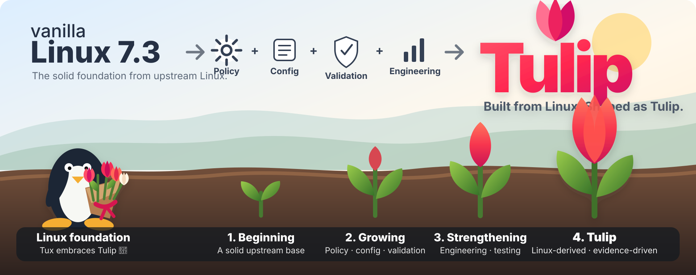

# Linux 7.3 Tulip — Public Releases 🌷

<p align="center">
  
</p>

<p align="center"><strong>Built from Linux. Shaped as Tulip.</strong></p>

| [🏠 Home](README.md) | [📦 Install](INSTALL.md) | [🌷 Why Tulip](WHY-TULIP.md) | [🛡️ Hardening](HARDENING.md) |
| --- | --- | --- | --- |

This repository is the **public release storefront** for Linux 7.3 Tulip.

Tulip is based directly on the upstream Linux kernel. It does not replace Linux or claim authorship of upstream Linux source.

[Tulip vs Linux 7.3](docs/comparison.md) · [FAQ](FAQ.md) · [Alpha 1 Notes](releases/alpha1.md) · [Tulip 1 Record](releases/tulip1.md) · [Source Provenance](SOURCE-PROVENANCE.md) · [Upstream](UPSTREAM.md) · [Security](SECURITY.md) · [Support](SUPPORT.md) · [License](COPYING)

---

## Quick start

Tulip is currently distributed as a source-oriented kernel release. Keep the working kernel supplied by your Linux distribution installed as a fallback while testing Tulip.

### ➜ [INSTALL.md](INSTALL.md)

The install guide covers source/release assets, configuration, build, modules, kernel installation, initramfs/bootloader considerations, Secure Boot, DKMS, verification and rollback.

New to Tulip or unsure which release to use? See the **[Tulip FAQ](FAQ.md)**.

---

## Why Tulip?

Tulip keeps upstream Linux 7.3 as its implementation foundation and adds a more explicit project policy around memory, hardening, integrity, validation and release evidence.

```text
Linux 7.3
+ Tulip policy
+ Tulip configuration
+ Tulip validation
+ Tulip release evidence
= Linux 7.3 Tulip
```

Main project directions include:

- **TulipMem** — MGLRU-focused memory policy
- **Tulip LowMem** — optional zram capability
- **TulipSched** — upstream scheduler retained as the normal default
- **TulipGuard** — curated Linux hardening profile
- **TulipTrust** — integrity/trust capabilities
- **TulipSpeed** — measurement-first performance policy
- **TulipTest** — additional build/boot/config validation evidence

### Why Tulip Is Hardened

Tulip uses a conservative kernel-hardening approach designed to make exploitation more difficult without turning security into a marketing claim.

Kernel hardening does not mean that Tulip is unhackable or free from vulnerabilities. Instead, it adds defensive layers intended to reduce attack opportunities, limit the impact of memory-safety bugs, and make successful exploitation more difficult.

Tulip currently makes use of established Linux security mechanisms such as:

- strong stack protection
- strict kernel memory permissions (RWX)
- kernel address space layout randomization (KASLR)
- fortified memory and string operations
- hardened userspace-to-kernel copy checks
- slab allocator hardening and randomization
- SELinux support
- module-signing support
- fs-verity and dm-verity integrity capabilities

The goal is **defense in depth**.

A vulnerability in a driver or kernel subsystem should not automatically become an easy path to full system compromise. Multiple independent protections increase the amount of work required to turn a bug into a reliable exploit.

Tulip deliberately avoids enabling every possible hardening option simply for the sake of claiming maximum security. Hardening decisions are evaluated together with compatibility, reliability, toolchain requirements, performance, and actual test evidence.

In short:

> **Harder to exploit. Safer when things go wrong. Practical to run.**

Security is treated as an engineering property to be tested and maintained — not a promise that vulnerabilities can never exist.

Tulip does **not** currently claim to be universally faster or universally more secure than vanilla Linux 7.3.

### ➜ [Read the full Tulip vs Vanilla Linux 7.3 comparison](docs/comparison.md)

---

## Release history

### Linux 7.3 Tulip 1

- Tag identity: `v7.3-tulip1`
- Audited release commit: `3a4ae31d5515b378e08a907ee6618eca185ef953`
- Classification: **Audited baseline release**
- Historical milestone state: `M0-M20 PASS VERIFIED`

See [`releases/tulip1.md`](releases/tulip1.md).

### Linux 7.3 Tulip 2 Alpha 1

- Tag: `v7.3-tulip2-alpha1`
- Classification: **Pre-release / Alpha / Testing**
- Engineering source identity: `8286db800faf7af273757cecfde8261ae9af54a7`
- Upstream Linux baseline: `v7.3`
- Upstream commit: `c03c1a14507dfaf8b856c2608f9ac216021fc222`
- Internal kernel release: `7.3.0-tulip2-alpha1`

The current public GitHub Alpha release provides the kernel image, configuration, modules archive, full source archive, manifest and SHA-256 checksum file.

See [`releases/alpha1.md`](releases/alpha1.md).

---

## Source and provenance

The public Alpha 1 source/provenance record is documented in:

### ➜ [`SOURCE-PROVENANCE.md`](SOURCE-PROVENANCE.md)

The release includes `tulip-7.3-tulip2-alpha1-source.tar.gz` and the exact release configuration. The upstream baseline can also be independently fetched and verified with:

```bash
./scripts/fetch-upstream-v7.3.sh
```

For Alpha 1, the recorded Tulip engineering delta from upstream Linux v7.3 consists of project documentation, configuration fragments and evidence reports; no upstream kernel source file modification is recorded by the repository comparison for the Alpha engineering commit.

---

## Important Alpha warning

Alpha 1 is not production-stable certification and has not been validated on every hardware platform supported by Linux.

When testing Tulip on a Linux system, keep the existing distribution kernel installed as a fallback.

---

## Repository roles

- **This repository** — public releases, installation guidance, comparison/advantages, FAQ, source/provenance, licensing and release-facing documentation.
- **Private engineering repository** — development history and ongoing engineering work.
- The former public engineering repository `haniffzain/tulip-kernel` is retired from canonical use.

---

## License

See [`COPYING`](COPYING).

Tulip retains the Linux kernel licensing framework, including:

`GPL-2.0 WITH Linux-syscall-note`

Other licenses may apply to individual parts of the upstream Linux source tree according to Linux kernel licensing rules.

---

## Creator and maintainer

Creator and Maintainer: **haniffzain**  
Contact: `haniffsp@proton.me`

## Upstream attribution

Upstream Linux repository: `https://github.com/torvalds/linux.git`

Tulip remains a Linux-derived project and preserves upstream attribution.
